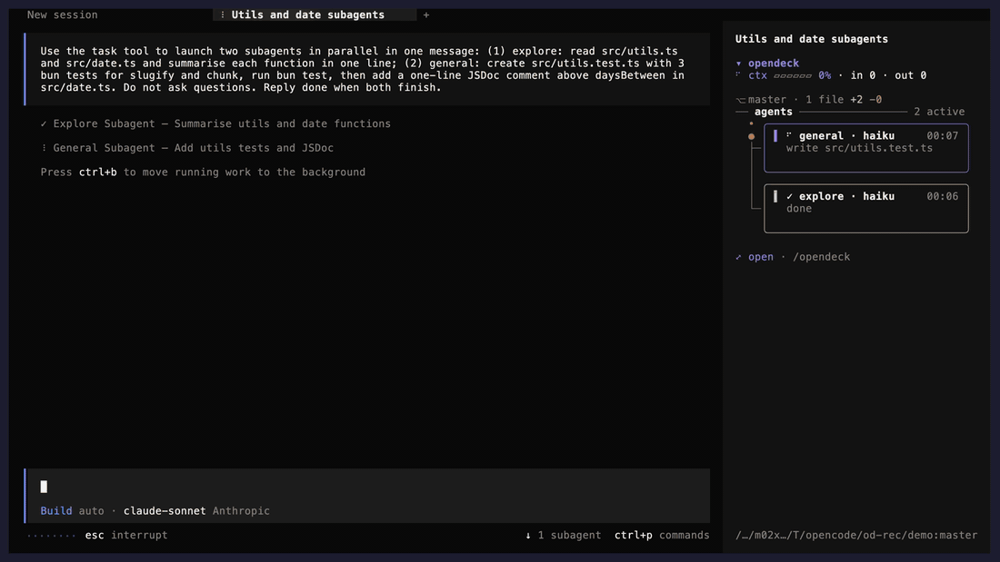
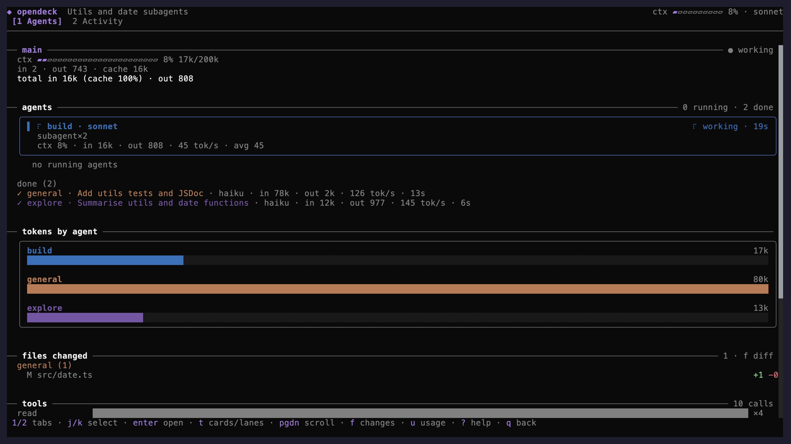
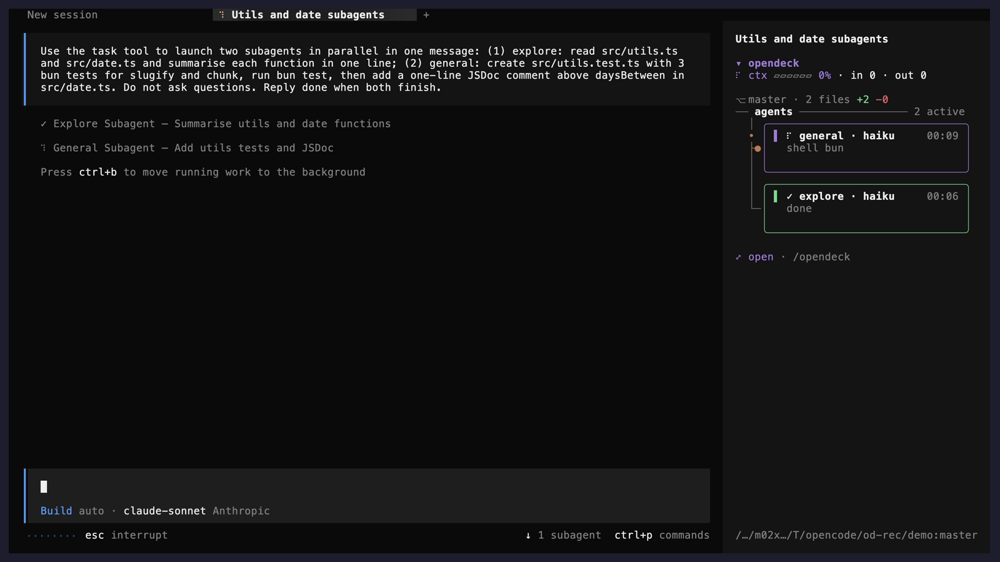
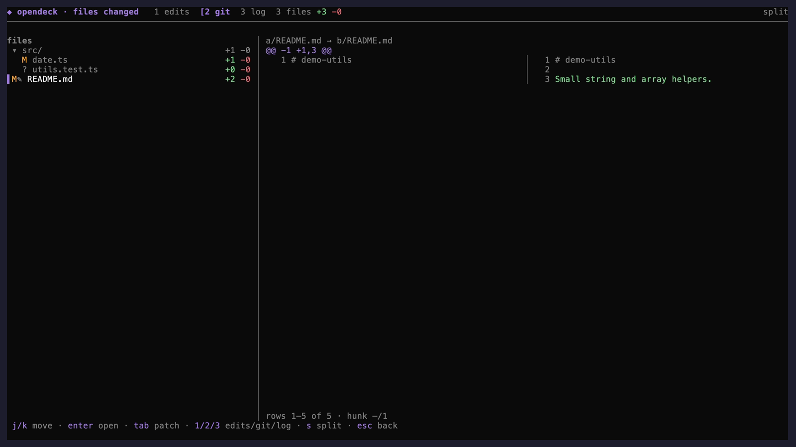
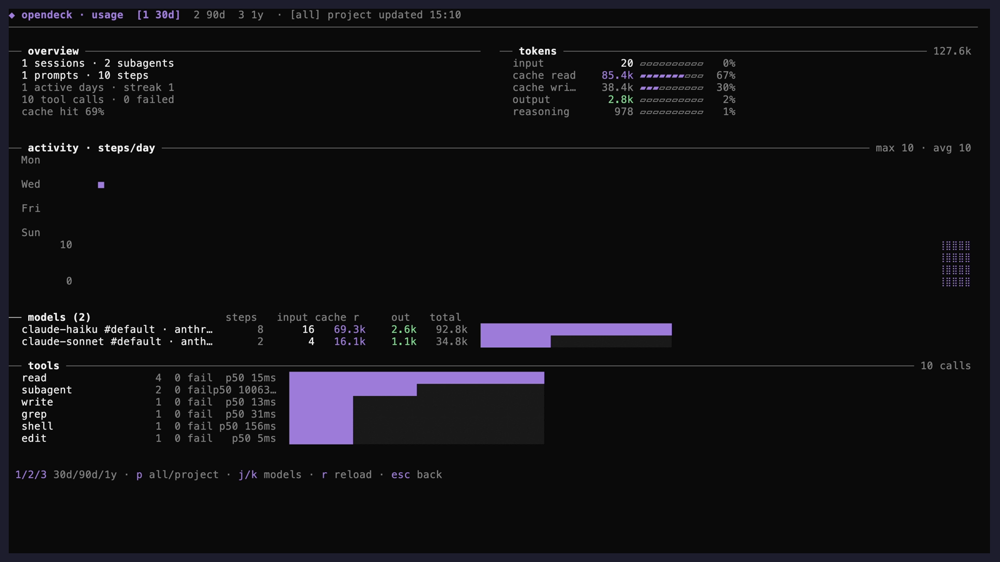

# opendeck

**A live mission-control dashboard for [OpenCode](https://opencode.ai) — see every agent, every token and every changed file without leaving the TUI.**




```bash
opencode plugin add github:ptthien1012/opencode-opendeck
```

Restart OpenCode, type `/opendeck`. More ways to install: [Install](#install).

When OpenCode fans out into subagents, the chat scroll stops telling you what is
going on. opendeck adds a compact sidebar and a set of full-screen pages that
answer the questions you actually have mid-run:

- *How full is my context, and how fast am I burning tokens?*
- *Which agents are running right now, what are they doing, and for how long?*
- *Is anything waiting for my approval?*
- *Which files changed — by which agent — and what did I edit by hand?*

## Features

| | |
|---|---|
| **Context gauge** | `ctx ▰▰▰▱▱ 42%` with in/out tokens, colour shifts at 70% and 85%, compaction warning |
| **Live agent tree** | every running subagent as a card or a swimlane: spinner, model, current tool, elapsed clock |
| **Approvals** | pending permission requests pulse in the sidebar; full history on the Activity tab |
| **Git at a glance** | `⎇ main · 5 files +120 −34` in the sidebar, refreshed on file events — no polling |
| **Files by agent** | which agent touched which file; files changed outside any agent are marked `✎` |
| **Diff page** | file tree + patch, split or unified, for session edits, the working tree or any commit |
| **Git log** | `git log --graph --all`, open any commit's files |
| **Opt-in git actions** | stage, unstage, discard and commit from the diff page (`gitWrite: true`) |
| **Usage page** | 30d / 90d / 1y token, cache, model and tool totals with a heatmap and daily chart |
| **Built for terminals** | one shared 120 ms ticker that stops when idle, scrollable pages, every row fits its width |
| **Private by design** | no network calls, no session mutation, secrets masked in tool rows |

## Install

Requires **OpenCode v2** (`2.0.0+`) and `git`. [Bun](https://bun.sh) is only
needed when you install from source with `--dev` / `-Dev`.

After installing, restart OpenCode and type `/opendeck`. The sidebar widget
appears automatically (`ctrl+x` then `b` if the sidebar is hidden).

### One command (macOS · Linux · WSL)

```bash
curl -fsSL https://raw.githubusercontent.com/ptthien1012/opencode-opendeck/master/install.sh | bash
```

This clones the repo into `~/.local/share/opencode-opendeck` and adds that
absolute path to the `plugins` array in `~/.config/opencode/cli.json` (the file
is backed up first, and re-running is idempotent). Pass `--dir <path>` to install
somewhere else, `--ref <ref>` to pin a branch/tag/commit, or `--dev` to build
`dist/` from source with Bun. `--uninstall` reverses it, `--help` lists
everything.

### Windows (PowerShell)

```powershell
irm https://raw.githubusercontent.com/ptthien1012/opencode-opendeck/master/install.ps1 | iex
```

Same options as flags: `-Dir`, `-Ref`, `-Dev`, `-Uninstall`, `-Yes`. It defaults
to `%LOCALAPPDATA%\opencode-opendeck` and writes the path with forward slashes.

### With the OpenCode CLI

```bash
opencode plugin add github:ptthien1012/opencode-opendeck
```

`dist/` is committed, so git installs need no build step.

### Manual / for contributors

```bash
git clone https://github.com/ptthien1012/opencode-opendeck.git
cd opencode-opendeck
bun install && bun run bundle
```

Then add the absolute path to the `plugins` array in `~/.config/opencode/cli.json`
(on Windows: `%USERPROFILE%\.config\opencode\cli.json`):

```json
{
  "$schema": "https://opencode.ai/v2/cli.json",
  "plugins": ["/absolute/path/to/opencode-opendeck"]
}
```

### Update / uninstall

Re-run the installer to update; use `--uninstall` (or `-Uninstall` on Windows)
to remove it, or `opencode plugin remove github:ptthien1012/opencode-opendeck` if
you added it through the CLI.

## Screenshots

**Agents tab** — the main agent and two parallel subagents, live:



**Sidebar** — context, git line and agent cards right next to the chat:



**Diff page, git tab** — agent edits next to a hand edit marked `✎`:



**Usage page** — tokens, cache, models and tools for this project:



## Pages and keys

| Page | Open | Keys |
|---|---|---|
| **Full view** | `/opendeck`, palette, or `⤢ open` | `1` Agents · `2` Activity · `j/k` select agent · `enter` open it · `t` cards/lanes · `pgup/pgdn` `ctrl+d/u` `g/G` scroll · `q`/`esc` back |
| **Diff** | `f`, the sidebar git line, or a file row | `1` edits · `2` git · `3` log · `j/k` move · `enter/l` open · `h` close dir · `tab` tree⇄patch · `n/p` hunk · `s` split/unified · `r` refresh |
| **Git log** | `3` on the diff page | `j/k` move · `enter` open commit · `pgup/pgdn` `g/G` · `r` reload |
| **Usage** | `u` | `1/2/3` 30d/90d/1y · `p` all projects ⇄ this project · `j/k` models · `r` reload |
| **Help** | `?` anywhere | every key per page and the symbol legend |

There is no default keybind to open the full view (`ctrl+g` belongs to the
host's `session.first`); bind your own to the `opendeck.open` command id. All
page keys live in keymap modes that exist only while that page is shown, so
they never fire over the prompt or a dialog.

## Options

Everything is optional; any invalid value falls back to its default.

```json
{
  "plugins": [
    {
      "package": "/absolute/path/to/opencode-opendeck",
      "options": {
        "animations": true,
        "doneLimit": 12,
        "gitLogLimit": 300,
        "gitWrite": false,
        "panels": { "stats": true, "charts": true, "errors": true, "files": true }
      }
    }
  ]
}
```

| Option | Default | What it does |
|---|---|---|
| `animations` | `true` | spinners, pulses, flashes, context tween, launch frames |
| `doneLimit` | `12` (1–100) | finished agents listed under Done in the sidebar |
| `gitLogLimit` | `300` (50–2000) | commits fetched for the git log |
| `gitWrite` | `false` | enables `space` stage/unstage, `a` stage all, `x` discard, `c` commit on the diff page's git tab (with confirm / message prompts) |
| `panels.*` | `true` | hide the `stats`, `charts`, `errors` or `files` panel on the Agents tab |

UI preferences (collapsed sidebar, cards/lanes, Done open, tab, usage range and
scope) are saved through the host's plugin storage and survive restarts.

## How it stays light

- **Read-only observer.** It reads the host's session store and listens to
  events; it never replies to permissions or edits sessions. The only writes are
  the opt-in `gitWrite` actions.
- **No network.** Git runs locally via `git -C <dir>` with a timeout; pathspecs are
  anchored at the repo root and taken literally.
- **One timer.** A single 120 ms ticker drives every animation and stops entirely
  when nothing is running. The git line refreshes on file, branch and tool events
  (debounced), never on an interval.
- **Secrets masked.** Tokens, bearer headers and `key=value` secrets are masked
  in tool rows and errors.

<details>
<summary><b>Sidebar sections in detail</b></summary>

- **Header** — `▾ opendeck · model`; click to collapse.
- **Context** — `ctx ▰▱ NN% · in X · out Y`; accent <70%, warning 70–85%, error >85%; spinner while the session runs.
- **Git** — `⎇ branch · N files +x −y` (or `· clean`); click opens the diff page on the git tab.
- **needs approval** — pending permission requests only; hidden when none.
- **Agents** — each active agent on two lines (spinner, name, short model, current tool + argument, elapsed clock). Finished agents collapse to `▸ Done 5 ✓4 ✗1`; click to expand. Click an agent to jump into its session.
- **⤺ back to Opendeck** — shown while a return to the full view is pending.
- **Footer** — `⤢ open · /opendeck`.

Every row is measured against the real slot width, truncated with an ellipsis, and never wraps.
</details>

<details>
<summary><b>Animations</b></summary>

- **Spinners** — braille frames on each running agent and on the `ctx` label; `✓` / `✗` when done / errored.
- **Live clocks** — per-agent elapsed time ticks while running.
- **Swimlanes** — in lanes mode each running bar's head pulses on a shared time axis.
- **Context bar** — tweens to new readings over ~400 ms and shifts colour by threshold.
- **Flash & pulse** — new permission requests flash for ~1.5 s; pending ones pulse.
- **Fan-out** — a new subagent plays a short `· → ◦ → ●` launch before its spinner.

Set `"animations": false` to freeze all of them; clocks keep updating.
</details>

## Development

```bash
bun install
bun run typecheck   # tsc --noEmit (strict)
bun run test        # bun test
bun run bundle      # rebuild dist/ after editing src/ (commit dist/ with your change)
bun run check       # typecheck + test + bundle
```

OpenCode hot-reloads file plugins; if it does not, restart it.

| File | Role |
|---|---|
| `src/index.tsx` | plugin entry: sidebar slot, five plugin routes, keymap layers |
| `src/state.ts` | reactive store: shared ticker, run tracking, permission and git events, navigation, prefs |
| `src/sidebar.tsx` | the compact sidebar |
| `src/fullview.tsx` | the full view (Agents / Activity tabs) |
| `src/panels.tsx` | Agents-tab panels: charts, tokens by agent, files, stats, errors |
| `src/diffview.tsx` · `src/gitview.tsx` · `src/usageview.tsx` · `src/help.tsx` | the other pages |
| `src/git.ts` | git parsers (pure, tested) and spawn wrappers |
| `src/metrics.ts` · `src/usage.ts` · `src/format.ts` · `src/num.ts` | pure helpers (tested) |
| `src/config.ts` | plugin options with defaults |
| `script/build.mjs` | Solid transform build |

Issues and pull requests are welcome.

## Credits

Inspired by [claude-flightdeck](https://github.com/scasella/claude-flightdeck), rebuilt for the OpenCode v2 plugin API.

## License

[MIT](LICENSE)
